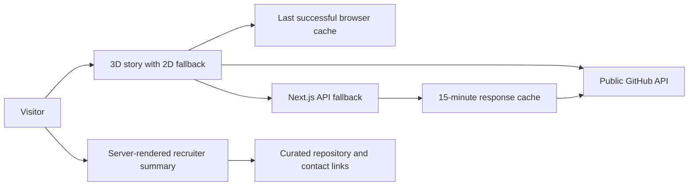

# Asitha Isuru — Interactive Portfolio

A personal life story built with **Next.js**, **Tailwind CSS**, **React Three Fiber** and **Three.js**. A procedural brick-style 3D avatar changes outfits as you explore education, work and skills; launching the project explorer takes you through a scroll-controlled galaxy of GitHub repositories and lands at the contact section.

The avatar follows Asitha's supplied LEGO reference: warm complexion, voluminous glossy swept black hair, printed short beard and moustache, black rectangular glasses with blue-tinted lenses, charcoal T-shirt and dark-gray trousers. Graduation, work, maker and pilot scenes add their own accessories. The likeness is modeled in Three.js geometry, so the original photograph is not bundled into the public website.

## Run locally

```bash
npm install
npm run dev
```

Open `http://localhost:3000`. Use `npm run build` to verify a production build.

## GitHub project planets

The browser reads the public GitHub API for [`asithaisuru`](https://github.com/asithaisuru), then falls back to `GET /api/projects` when needed. The server endpoint caches GitHub results for **15 minutes**. A last known successful browser response is also stored for up to seven days, so visitors can still explore recently fetched projects if GitHub is temporarily unreachable. New public repositories appear automatically when GitHub returns an updated list. Forks, private/archived repositories, `portfolio`, and the `asithaisuru` profile repository are excluded. Every project planet links to its real repository and optional live site.

GitHub may rate-limit anonymous API requests. For more reliable server fallback requests, set a server-side `GITHUB_TOKEN` in `.env.local` or your hosting provider's environment variables. It is **optional**; never expose it as `NEXT_PUBLIC_` or commit it to Git. If neither API connection nor a recent cached response is available, the explorer shows a retry button and a link to the public profile.

## Controls

- Scroll through the life story to meet a different character in each chapter. Characters stay inside their chapter instead of traveling with the page; hover or focus the story cards to trigger gestures, and move the pointer to make the character look around.
- Select **Launch project explorer** to board the ship. In the center launch bay, your spaceship waits for the first scroll or tap; then it steers left/right opposite each planet. Scroll, swipe vertically, use the arrow keys, or click the on-screen buttons. Inside a long project card, scrolling reads its description before traveling to the next planet.
- Press **Escape** or **Exit to story** to return. Travel past the final project to land at the contact section.
- On the contact planet, watch the avatar walk from the spaceship to the terminal and press its controls. Hover or focus Email, Call, GitHub, or LinkedIn to choose the key the character operates.
- Motion-sensitive visitors get shortened animations via `prefers-reduced-motion`. Devices without WebGL display a 2D fallback.

The avatar and planets are procedurally modeled in `components/brick-world.tsx`, so no third-party models, licenses or remote asset downloads are needed.


## Recruiter access and verification



Open `/recruiter` for a server-rendered overview of skills, education, experience, certification, the four selected repositories, contact links and the approved public CV download at `/Asitha_Isuru_Public_CV.pdf`. It needs no GitHub API, JavaScript or WebGL. The hero links and keyboard skip link make it accessible directly from the 3D story. The previous public PDF filename is removed from the current assets.

Use Node.js 24.22.3 LTS or a later patched 24.x release, `npm ci`, `npm run dev` and `http://localhost:3000`. Copy `.env.example` to `.env.local` only if the optional server-side token is needed. Never use a `NEXT_PUBLIC_` token. GitHub requests have per-request timeouts; the existing browser cache/server fallback/error states remain. Curated recruiter links are independent of the live feed. A cached live feed may be up to seven days old.

```bash
npm run lint
npm test
npm run build
npm run typecheck
npm start
```

Build before the standalone type check so Next.js has generated its route types, including on a fresh checkout. The tests use mocked GitHub responses, including malformed data, 403 errors and pagination; they never require a token. Lint uses the installed Next.js ESLint configuration, with strict default effect rules and a narrowly documented imperative Three.js scene mutation exception. Browser capabilities, media queries and carousel events use external-store subscriptions. Security dependencies were updated and require the accompanying lockfile. Reduced-motion visitors use 2D canvas fallbacks; the recruiter page is always static. Verify keyboard focus, narrow screens, no-WebGL and GitHub failure in browser smoke tests as well.

Deployment note: this application has a dynamic `/api/projects` route and targets a Next.js server host such as its existing Vercel URL. The incompatible legacy GitHub Pages deployment workflow was removed: it expected `out/` although this is not a static export. Keep the existing Vercel Next.js configuration; no static-export setting is added. New CI is validation only, and no deployment is performed.

The public CV is the owner-supplied publication copy. Website descriptions follow that CV while distinguishing the public reconstruction prototype from separate research software and synchronized playback state from multi-device audio. Local build and browser results do not by themselves establish the state of a hosted deployment.
